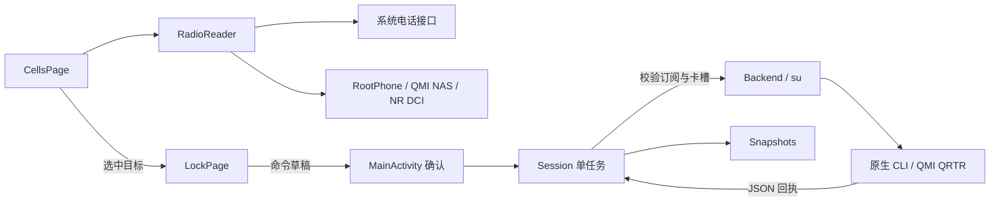

# 参与开发

## 环境

- JDK 17
- Android SDK：platform 35、Build Tools 35.0.0
- Android NDK：`30.0.14904198`（与 CI 一致）
- PowerShell（Windows 自带；Linux / macOS 使用 `pwsh`）

工程使用 AGP 8.7.3、Gradle Wrapper 8.11.1；minSdk 30 / targetSdk 34，原生后端仅构建 arm64-v8a。

## 构建

在项目根目录创建 `local.properties`（路径使用正斜杠）：

```properties
sdk.dir=C:/path/to/android-sdk
```

先编译原生后端，再打包 APK：

```powershell
./build-native.ps1 -Ndk <NDK目录> -BuildTests
./gradlew assembleDebug lintDebug
```

原生 `.so` 缺失时 Gradle 会直接报错，不会产出没有后端的 APK。

### 正式签名

Release 构建按以下顺序读取签名配置，均未配置时输出未签名 APK：

1. 环境变量 `CELLLOCK_KEYSTORE`、`CELLLOCK_KEYSTORE_PASSWORD`、`CELLLOCK_KEY_ALIAS`、`CELLLOCK_KEY_PASSWORD`
2. 根目录的 `keystore.properties`（已在 `.gitignore` 中忽略）：

```properties
storeFile=release.jks
storePassword=...
keyAlias=...
keyPassword=...
```

```powershell
./gradlew assembleRelease
```

## 发布

1. 修改 `app/build.gradle` 中的 `versionCode` 与 `versionName`，并在 `CHANGELOG.md` 顶部添加 `## <版本号>` 小节。
2. 提交后打标签并推送：`git tag v<版本号> && git push origin v<版本号>`。
3. [Release workflow](.github/workflows/release.yml) 会校验版本号与标签一致、运行测试、构建签名 APK，并创建 GitHub Release（APK、源码包、`SHA256SUMS.txt`，说明取自 CHANGELOG 对应小节）。

workflow 需要仓库 secrets：`CELLLOCK_KEYSTORE_BASE64`（keystore 文件的 base64）、`CELLLOCK_KEYSTORE_PASSWORD`、`CELLLOCK_KEY_ALIAS`、`CELLLOCK_KEY_PASSWORD`。

## 测试

所有自动测试均不向基带发送命令。

| 测试 | 运行方式 |
|---|---|
| 原生协议自检 | `test_qmi.c`、`test_efs.c` 可用主机 GCC 编译运行：`gcc -std=c11 -O2 -Wall -Wextra -Werror -o test_qmi native/test_qmi.c`；`-BuildTests` 生成的 Android 版本可 `adb push` 到手机运行 |
| 主机逻辑测试 | `./tests/run-host.ps1 -AndroidJar <sdk>/platforms/android-35/android.jar -JsonJar <json-20240303.jar>`，[JSON-java](https://repo.maven.apache.org/maven2/org/json/json/20240303/json-20240303.jar) 仅作测试运行库 |
| Root 会话 | `./tests/run-root-shell.ps1 -JsonJar <jar> -Jdk <JDK目录>`，用假 `su` 覆盖复用、并发、失效重建与写入不重发（Windows，需要 GCC 与 Git for Windows 的 `sh.exe`） |
| 界面与弹窗 | 安装 debug APK 后运行 `./tests/run-ui.ps1 -Sdk <sdk>`，执行 `UiFlowTest` 与 `DialogFlowTest`，结束后卸载测试包 |

`ModemFlowTest`（真实写入并恢复）与 `DeviceReadingTest`（真机只读核对）需要显式运行，只应在可恢复配置的测试机上使用。`tests/fixtures/` 中的现场样本已脱敏，由 `NasVerificationTest` 重放。

## 项目结构

| 路径 | 职责 |
|---|---|
| `MainActivity.java` | 三页容器、SIM 选择、确认弹窗、权限、导出及进程内 `Session` 任务协调 |
| `CellsPage.java` | 前台读取调度、服务 / 邻区展示、信号曲线 |
| `LockPage.java` | 小区 / 频段 / 制式表单与参数校验 |
| `DevicePage.java` | 机型、硬件频段、权限、后端状态与操作记录 |
| `RadioReader.java`、`SimInfo.java` | 读取路径选择、SIM 映射、设备能力退避 |
| `RootShell.java`、`RootPhone.java` | 常驻 Root 会话与电话服务读取 |
| `MeasurementDecoder.java`、`DiagnosticCells.java` | UIM / NAS 与 NR 测量解码、邻区缓存 |
| `RadioCell.java`、`Bands.java` | 小区模型、去重与频段推算 |
| `Backend.java`、`Models.java` | 调用原生后端并解析 JSON 回执 |
| `Snapshots.java`、`SavedCells.java`、`SavedRecords.java`、`LockPlan.java` | 配置快照、小区收藏、操作记录与目标频段合并 |
| `BandDefaults.java` | 快速 / 完整清除编排 |
| `Ui.java`、`FlowLayout.java`、`LineIcon.java`、`SignalChartView.java` | 界面组件与绘图 |
| `native/` | QMI / QRTR、DIAG、EFS 原生后端，命令接口见 [native/README.md](native/README.md) |
| `tests/` | 主机与 Android 测试 |



## 约定

- 写入后必须回读确认；状态无法确认时显示“未知”，不要当作未锁定。
- 可能已发出的写入请求不得自动重发。
- 不添加联网权限、统计或广告 SDK。
- 提交中不要包含 `local.properties`、签名文件、设备标识或未脱敏的现场数据。
