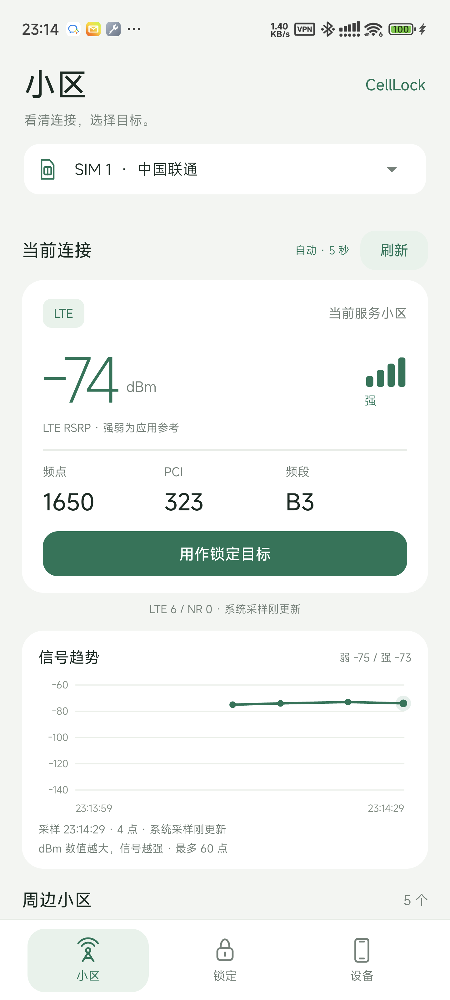
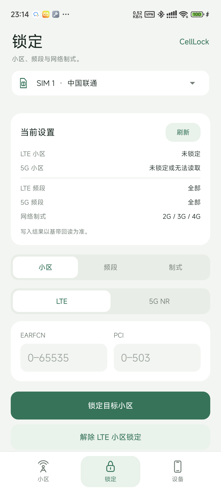
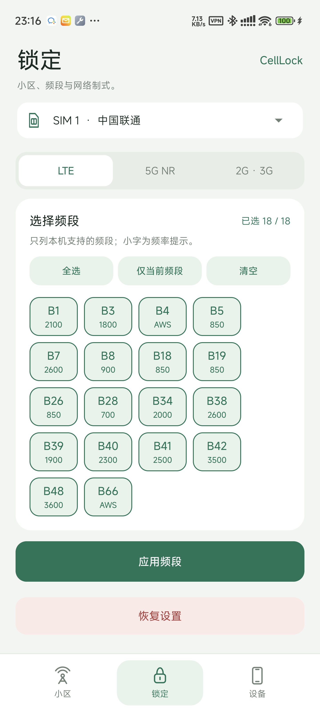

# CellLock 0.3.0

已 Root 高通手机上的免费网络设置工具。当前适配目标为小米 14 Pro（23116PN5BC / SM8650 / Android 14）。无会员、广告或联网 SDK，应用未声明 `INTERNET` 权限。

## 下载与开发

[下载 v0.3.0 APK 与完整源码](https://github.com/SAGIRIxr/CellLock-QMI/releases/tag/v0.3.0) · [开发交接文档](docs/DEVELOPMENT.zh-CN.md)

## 功能

- **小区**：查看服务小区与邻区，前台约每 5 秒刷新；显示信号强弱及最近 5 分钟、最多 60 点的真实采样曲线。缓存不重复绘点，切卡清空历史。
- **锁定**：LTE 小区锁、5G NR 小区或频点锁；选择 LTE、NR、GSM、WCDMA 频段；设置网络制式与 5G SA / NSA 组网。
- **设备**：查看机型、硬件支持频段、Root / 后端状态、读取权限和操作记录，按需导出诊断。

0.3 已从 App 验证 SIM 1 的 LTE B3 频段设置、SIM 2 的 NR SA + NSA n1 / n78 设置；直接调用同一后端也验证了双卡制式与 SIM 2 组网切换，随后完整恢复原值。SIM 2 的 LTE 小区锁配置及解除均已回读确认，实际 LTE 目标驻留未验证。**NR 小区锁和 ARFCN 频点锁的实际效果尚未完成实机验证**；即使已观测到真实 NR 服务，成功空应答仍按锁定状态未知处理。最终两卡配置与测试前一致，移动数据及漫游保持关闭。具体回执见 [验证记录](native/VALIDATION.md)。

## 界面

  

## 使用

1. 安装 APK，在 Root 管理器中允许 CellLock；在“设备”页授予电话、精确位置权限，并开启系统定位。
2. 选择上方 SIM，进入“锁定”页读取当前配置；软件按每张卡保存首次完整读取的初始频段与制式。
3. 从“小区”页选择目标，或在“锁定”页选择“小区 / 频段 / 制式”，核对参数后确认写入。NR 频段与 SCS 建议值可以手改。
4. 查看回读结果。配置确认后，可返回“小区”页观察实际驻留；两者不是同一项验证。

目标错误或仅选择无覆盖的网络可能暂时断网；离开目标覆盖区前记得恢复。应用不会打开移动数据或数据漫游。

## 两种恢复

- **恢复初始设置**：恢复该 SIM 首次保存的频段、制式和 NR 组网，并请求清除小区锁。恢复按完整原值比对，保留初始配置中硬件不支持的频段位。
- **全部开放**：开放本机硬件支持的频段与制式，启用 SA + NSA，并请求清除小区锁。它会改变原有频段限制，不能代替“恢复初始设置”。

NR 状态仍未知时，清锁或整套恢复可能显示“未全部确认”；不要把这一结果理解为已解除。两条路径均不删除其他工具的 EFS 文件。两张 SIM 分别保存初始配置，操作前核对所选卡。

## 构建与测试

需要 JDK 17、Android SDK 35、Android NDK。Gradle Wrapper 已随源码提供。在项目根目录的 `local.properties` 配置 `sdk.dir`，然后运行：

```powershell
./build-native.ps1 -Ndk 'C:/你的/android-sdk/ndk/30.0.14904198' -BuildTests
./gradlew.bat assembleDebug lintDebug
```

APK：`app/build/outputs/apk/debug/app-debug.apk`。用户交付目录为项目外的 `../../../outputs/`。

纯测试入口为 `tests/InputValidatorTest.java`、`tests/SignalHistoryTest.java`、`tests/SnapshotsTest.java` 和 `native/test_qmi.c`。快照测试需要 Android 的 `org.json`；编译为 dex 后可通过 `app_process` 执行。全部纯测试只检查逻辑，不发送基带命令。结果、设备测试和未验证项见 [验证记录](native/VALIDATION.md)；0.2 历史证据见 [历史记录](native/VALIDATION-0.2.md)。

## 许可

GPL-3.0-only，交付完整源码。协议与传输参考公开的 qcom-band-menu、bunnylock，固定版本与许可见 [native/SOURCES.md](native/SOURCES.md)。未使用或分发 Cellular-Pro 私有代码、授权接口或手机厂商库。
