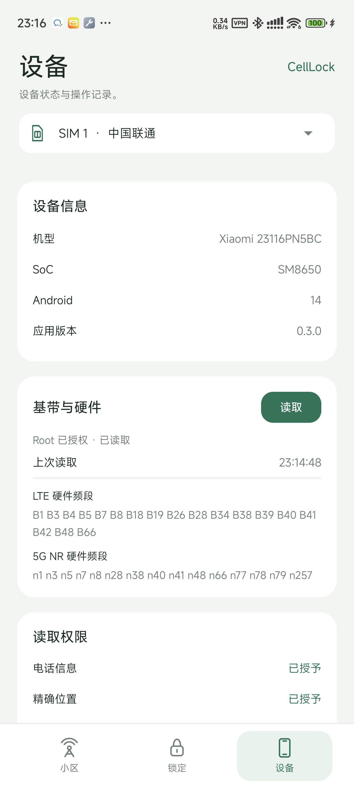

# CellLock 0.4.9（本地构建，未发布）

已 Root 高通手机上的免费网络设置工具。写入功能在小米 14 Pro（SM8650 / Android 14）验证，0.4 自适应读取另在 SM8250 / Android 13 / MIUI 14 验证。无会员、广告或联网 SDK，应用未声明 `INTERNET` 权限。

[下载 v0.3.0 APK 与源码](https://github.com/SAGIRIxr/CellLock-QMI/releases/tag/v0.3.0) · [开发交接文档](docs/DEVELOPMENT.zh-CN.md) · [更新日志](CHANGELOG.md)

## 功能

- **小区**：综合普通接口、Root 电话、QMI NAS 与 NR 诊断读取所选 SIM 的服务小区和邻区，自动校正冲突的 NR 频段，并绘制最近 5 分钟的信号曲线。
- **锁定**：LTE 小区锁、5G NR 小区或频点锁；选择 LTE、NR、GSM、WCDMA 频段；设置网络制式与 5G SA / NSA 组网。
- **设备**：查看机型、硬件支持频段、Root / 后端状态、读取权限和操作记录，按需导出诊断。

## 界面

   

## 使用

1. 安装 APK，在 Root 管理器中允许 CellLock。应用按已有权限自动选择读取方式；手动“刷新”仍读不到时才引导授权，不自动修改权限或定位开关。
2. 选择上方 SIM。首次完整读取会自动保存配置快照，后续刷新不覆盖；可在锁定页右上角“配置管理”新增快照。
3. 从“小区”页选择目标，或在锁定页核对并填写参数。目标被当前完整允许列表排除时，确认锁定会自动追加目标频段；空频段选择不能应用。
4. 查看操作回执，再观察实际驻留；配置回读成功不等于已驻留目标。

目标错误或选择无覆盖的网络可能暂时断网，离开目标覆盖区前记得恢复。应用不会打开移动数据或数据漫游。

## 配置与清锁

- **保存 / 读取配置**：按 SIM 保存多份快照和备注，恢复其中已知的配置与小区锁；未知项跳过。EFS 原字节仅记录，不自动恢复。
- **快速清除**：开放所选 SIM 的硬件支持频段，清除 LTE / NR 运行时小区或频点锁，保留制式和组网，不主动重启基带。
- **完整清除**：处理已适配的持久锁项与制式偏好，并重启基带一次。重载影响双卡，结束后需手动刷新；不保证所有厂商锁项均已清除，也不自动确认重载后的状态。
- **开放全部支持频段**：只调整支持频段，保留小区锁、制式与组网。
- **专用清除**：表单中的清除按钮只解除对应 LTE 或 NR 小区 / 频点锁，不改频段。

写入前可选择备份；备份失败会停止操作。快照不能保证恢复完整清除删除的全部持久项，两种清除均不需要登记默认范围。

长按服务小区或周边条目可添加备注并保存，通过小区页书签或表单的“已保存小区”查看。历史记录只填入表单，由用户核对后确认锁定；应用不提供独立定向扫描。

写入与清除仅在有限设备和条件下验证；NR 清除后状态仍可能未知，不能把请求被接受视为已确认无锁。详见 [验证记录](native/VALIDATION.md)。

## 构建与测试

需要 JDK 17、Android SDK 35、Android NDK。在项目根目录的 `local.properties` 配置 `sdk.dir`，然后运行：

```powershell
./build-native.ps1 -Ndk 'C:/你的/android-sdk/ndk/30.0.14904198' -BuildTests
./gradlew.bat clean assembleDebug lintDebug
```

`tests/` 下的纯逻辑测试不发送基带命令，运行方式见 [开发交接文档](docs/DEVELOPMENT.zh-CN.md)。

## 许可

GPL-3.0-only，交付完整源码。协议与传输参考公开的 qcom-band-menu、bunnylock，固定版本与许可见 [native/SOURCES.md](native/SOURCES.md)。未使用或分发 Cellular-Pro 私有代码、授权接口或手机厂商库。
