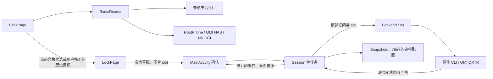

# CellLock 开发交接

本文描述当前实现与开发入口。用户操作见 [README](../README.md)，版本变化见 [CHANGELOG](../CHANGELOG.md)，历史证据与验收边界见 [验证记录](../native/VALIDATION.md)。源码版本为 **0.4.9 / versionCode 13**，尚未发布，公开下载仍为 v0.3.0。

## 1. 当前边界

应用为已 Root 高通设备提供本地网络设置，无联网权限、账号、广告或联网 SDK。写入曾在 SM8650 / Android 14 验证，读取及当前集成在 SM8250 / Android 13 / MIUI 14 验证；这些结果不代表通用支持。

配置管理提供多份普通快照、独立频段开放及快速 / 完整清除。默认范围登记入口及任务已移除，旧记录不参与决策；旧 clear-all / register-default 确认须重新选择。快速清除保留 RAT / NR mode；完整清除在固定持久项核对后仅发送一次 SSR，影响双卡，不等待恢复、不补写，最终状态保持未核验。

Root 授权缓存与常驻 su shell 在进程内复用，后台和空闲不主动关闭；失效时有限重建。撤销授权不保证已有 UID0 shell 立即失权；可能已发出的写请求不得重发。DIAG / EFS 正常清理未确认时暂停后续基带操作。

普通订阅受限时依次尝试 Root 电话、UIM 与公开卡状态；UIM-only 不伪造 subId。小区优先使用有新时间戳的普通测量，再尝试 Root 电话、严格绑定的 NAS 及设备级 NR DIAG。Root 可用且映射未改变时，即使电话服务身份完整也补读 NAS；隐藏 API 跨 ROM 失败时须回退，不自动修改权限或定位。Root 拒绝后不自动重复申请，用户手动刷新可重试。

源码为 Java 原生界面与 NDK arm64 C 后端，QMI 使用 QRTR。文中源码路径相对于项目根目录；开发约定不依赖聊天记录。

### 读取与分类

- **QMI 补全**：每卡独立绑定 NAS，在共用 6 秒期限内依次查询 SYS `0x004D` → LOC `0x0043` → RF `0x0031` → SIG `0x004F` → SYS。前后订阅映射、服务身份及 RF 关联通过核验才补缺；单项可选查询失败不丢弃其他有效数据。SIG 不分配给缺少有效服务身份的邻区，也不借用旧电话时间绘制曲线。
- **频段与 SCS**：合法系统频段保留；频段与频点冲突时优先使用关联正确的 RF，或唯一频点候选。重叠候选无法确认时表单频段留空，由用户确认；显示、邻区匹配和命令采用同一有效频段。基带 SCS 仅供参考，不等于已验证适合锁定命令。
- **周边分类**：所选卡的有效电话 / NAS 邻区与合格同频候选进入周边列表；其余有效观测进入默认折叠的“其他观测”，不计入周边数。纯频点提示隐藏，身份冲突不强行合并；条目隐藏“SIM 归属未知”文字，但保留底层归属判断。两卡独立处理，没有卡 2 只能 LTE 的限制。
- **去重与展示**：`RadioCell.sameCell / surrounding / isNeighborOf` 统一判断去重和周边资格。不同完整身份、TAC 或已确认频段不合并；服务选择先比较可信映射，再比较 NR / LTE 与身份完整度，避免未映射 NR 抢占可信 LTE。隐藏来源文字不删除底层 details 或诊断信息。
- **覆盖范围**：LTE 已有异频点、异频段真机证据；NR 解码支持多载波，但既有调查中的真包不能证明 NR 异频覆盖。DIAG 仍仅接受 `0xB97F` 2.7、约 3 秒短会话；延长缓存不能补出基带未返回的数据。服务匹配只提供候选，不证明某张 SIM 独占该观测。

- **邻区容错**：逐包拒绝未知版本或损坏内容，保留其他有效包；每批最多 32 包 / 96 KiB / 512 个解码小区，缓存 15 秒。诊断摘要通过现有 TXT 导出，不新增后台采集。

## 2. 目录与职责

| 文件 | 主要职责 |
|---|---|
| `app/src/main/java/com/celllock/app/MainActivity.java` | 三页容器、SIM 选择、确认弹窗、权限、导出，以及进程内 `Session` 任务协调 |
| `CellsPage.java` | 前台读取调度、服务 / 邻区、来源与缓存、信号曲线；交给统一协调器读取 |
| `RadioReader.java`、`SimInfo.java` | 按接口选路、真实 SIM 映射、回调取消与设备能力退避 |
| `RootShell.java`、`RootPhone.java` | 串行有界 Root 进程、电话服务 helper；不修改权限或系统开关 |
| `MeasurementDecoder.java` | 有界 UIM/NAS 与 NR 2.7 解码，隔离未知版本与损坏包，保留有效测量 |
| `LockPage.java` | 小区 / 频段 / 制式表单，硬件频段芯片，参数校验，生成待确认命令 |
| `DevicePage.java` | 机型 / SoC / 版本、硬件频段、权限、后端状态与记录 |
| `Backend.java` | 订阅 ID 转物理卡槽，调用随包 ELF，收集与解析 JSON |
| `Models.java` | 制式、状态、逐项操作结果及记录模型；未知状态和偏好 / 硬件分离 |
| `Snapshots.java` | 分 SIM 多份配置快照、旧格式兼容、恢复命令与全值匹配 |
| `SavedCells.java`、`SavedRecords.java`、`LockPlan.java` | 小区收藏、记录持久化与目标频段并集 |
| `BandDefaults.java`、`native/celllock_efs.c`、`efs_protocol.inc` | 固定 EFS 证据、清理编排与单次重载 |
| `RadioCell.java`、`Bands.java` | 系统 CellInfo 简化、频段查找与 SCS 建议；建议值不是测量值 |
| `SimStatus.java` | 区分电话未授权、SIM 信息读取受限、无卡和可用订阅 |
| `SignalHistory.java`、`SignalChartView.java` | 真时间戳去重、滚动窗口、断线、Canvas 绘图 |
| `Ui.java`、`FlowLayout.java`、`LineIcon.java` | 配色、控件、流式芯片与本地矢量图标 |
| `InputValidator.java` | 输入范围、频段与频点等约束 |
| `native/celllock_qmi.c`、`qrtr_transport.inc` | 固定 CLI、QMI 编码 / 解码、严格 SIM 绑定、读后验证 |
| `native/celllock_read.c`、`celllock_diag.c` | 固定只读查询和短 DCI 会话，未确认正常清理时暂停基带操作 |
| `native/test_qmi.c`、`test_transport.inc` | 完全替换真实传输的原生测试；不访问基带 |
| `tests/*.java` | 参数、快照、信号历史纯逻辑测试 |
| `docs/DEVELOPMENT.zh-CN.md`、`docs/images/` | 公开开发交接与 README 界面截图 |
| `CHANGELOG.md` | 各版本更新说明 |

核心调用关系：



公开源码不包含本地 `AGENTS.md` 和私人设备记录；接手时以本交接文档及 `native/VALIDATION.md` 为基线，先读取新设备状态，避免沿用旧机器配置。

## 3. 前台刷新与图表

`CellsPage` 由 Activity 调用 `setSim()`、`setForeground()`、`setBusy()` 和 `dispose()`。

- 小区页前台请求完成后约 5 秒安排下一次，页面 30 秒超时；普通更新 4 秒后转入回退，Root helper 各自有期限。只有一个定时 Runnable 和一个有效在途请求。
- callback 必须同时匹配请求 generation、捕获的 subscription ID、前台状态、非 busy 状态和 reading 标记。旧请求不得结束或覆盖新请求。
- 暂停、销毁、切 SIM 时取消定时与超时回调，增加 generation；迟到的系统回调会被丢弃。
- Session 读取或写入期间暂停观测，任务结束后恢复。普通权限/定位只限制具体系统小区接口，Root 读取路径仍尝试；只有手动操作在实际来源不可用时引导授权。无 SIM 映射仍可显示设备级观测。
- `SimStatus` 区分未授权、读取受限、无卡和正常订阅；Root 提供真实订阅时界面可以选择卡，但设备页仍准确显示主 App 电话权限未授予。UIM 与公开卡状态不补造 subId，未知归属不能作为锁网目标。
- 瞬时空列表与超时保留最近有效列表，注明接收年龄；超过 60 秒或未知时间的目标不可填入。Root 拒绝后自动轮询不反复请求，手动刷新可重试；DIAG 无日志退避 60 秒，库/ABI/版本不支持时暂停，手动刷新可重新探测。
- `CellInfo.getTimestampMillis()` 与 `SystemClock.elapsedRealtime()` 使用同一时间基准。相同 / 倒序 / 未来 / 超过窗口的时间戳不产生新点；不能用 callback 到达时间伪造采样。
- 最近 5 分钟、最多 60 点。LTE RSRP 与 NR SS-RSRP 使用相同图表，但 RAT、频点、PCI、身份变化时断线；空观测、后台、超时也断线，不填零或插补。
- 切卡清历史；同卡旋转通过 Bundle 保存样本，恢复后先断开连线。信号颜色和“强 / 弱”仅为应用参考。

不要把“每 5 秒请求”改写成“每 5 秒保证新样本”，也不要每次自动刷新都写操作日志，避免重要写入回执被挤掉。

## 4. Session 与旋转恢复

`MainActivity.Session` 是静态进程内对象，持有单线程 executor、running 状态、按 subscription ID 分类的状态 / 时间 / 记录，以及最新 Completion。它只弱引用 Activity，后台任务持有 ApplicationContext。

执行写入的顺序是：

1. 确认弹窗捕获 subscription ID、slot 和命令副本；确认时再次核验目标。
2. Session 的 QMI 命令前后核验真实订阅，固定 EFS 操作前同样核验。SSR 是终结步骤，发送后不做后置 verifySlot 或服务恢复读取；映射改变在重载前停止后续操作。
3. 写前先执行 `state`，按路线核验必要字段；快速开放要求硬件范围，完整清除不以硬件列表阻断。可选备份失败不写入，未知项保留未知。
4. 执行固定命令，保存原始回执；一般操作遇失败停止，快照恢复会继续收集各恢复项结果。
5. 普通写入/快速清除最后重新读取，快照恢复另执行 `Snapshots.matches()`。完整清除仅在重载前核对必要步骤，重载后立即结算未核验，不自动最终回读。
6. 主线程派发 Completion，按 ID 防止重复消费；Activity 回到前台或旋转后继续接收结果。

旋转时 Activity 不取消已经开始的基带操作。旧界面 detach，executor 允许在途任务收尾；新界面 attach，继承 busy 和回执。可见的结果弹窗另存 Bundle，旋转后可重建。不要把耗时 `su` 调用放回主线程。

Session 不跨进程持久化，未完成任务不得重放。完整清除在 SSR 前提交 reloadPending 标记，重载后清两卡状态、能力及测量缓存；页面切换、恢复前台或进程重建不自动恢复读取。用户手动刷新或发起新任务才解除待刷新标记，并重新核验真实 SIM；普通快照保留。

## 5. 原生 CLI 与协议

`libcelllock_qmi.so` 虽然扩展名为 `.so`，实际是可执行 ELF，用于随 APK 打包；不是通过 JNI 加载。必须保留 `extractNativeLibs=true`，从 `nativeLibraryDir` 的实际文件路径执行。

完整命令、参数与回执字段见 [原生后端说明](../native/README.md)，字段来源见 [SOURCES](../native/SOURCES.md)。

`slot` 是物理卡槽 0/1，不是 Android subscription ID。列表是逗号分隔数字。LTE EARFCN 限 0–65535、PCI 0–503；NR ARFCN 0–3279165、PCI 0–1007；SCS 单位 kHz，只接受 15/30/60/120/240。普通 UI 命令不携带 slot，由 Session 统一插入；`Snapshots.restoreCommands()` 输出带 slot，MainActivity 转换后再交 Session，改接口时注意避免重复插槽。

协议关键点：

- NAS service 3，绑定消息 0x0045 必须成功；DMS service 2 的同号消息是硬件频段查询，不能混淆。
- LTE GET/SET：0x00D7 / 0x00D8。GET EARFCN 为 16 位，SET 为 32 位，现版本因此限制 LTE 范围以保证可验证。
- NR GET/SET：0x010F / 0x010E。type 0 为 PCI，1 为 ARFCN，2 为 NONE。PCI payload 包含 PCI、SCS 枚举、ARFCN 和 64 字节频段掩码。
- System selection GET/SET：0x0034 / 0x0033；GET 与 SET 的扩展 LTE、NR SA / NSA TLV 编号不同。详细映射见 `native/SOURCES.md`。
- RAT 的 GSM/WCDMA/LTE/NR 位为 0x04/0x08/0x10/0x40；NR mode 的 0/1/2 为 both/nsa/sa。
- 系统选择可能异步生效，后端有限期重复读取。原生期限 25 秒，App 每次 Root 外层等待 40 秒。只有明确的不支持错误才允许协议字段降级，超时不得当成“未写入”后随意重发。

回执是一行 JSON。`ok` 表示本次目标通过回读；`mutated` 是尝试写入，`writes` / `accepted` 分别记录次数；`stage=unverified` 可能已有部分变更。状态包含 `lteCell`、`nrCell`、`pref`、`hardware`，缺失 hardware 可从同订阅先前结果继承，不能跨卡继承。

## 6. 快照与清锁约定

快照键沿用 `snapshot_<slot>_<subscriptionId>`，新增项使用 schema 3，保留 schema 2 和旧单对象兼容。频段、制式、组网可为显式 null，锁状态以 known/type 记录；LTE 保存完整列表，NR PCI 保存完整 bands，NR 频点保存完整 ARFCN/SCS 列表。旧快照没保存的锁状态不清除，其他 NR 类型只记录。恢复后完整比对原值，LTE/NR 列表比较保留重复数量并允许重排。损坏列表不覆盖；删除最后一份保留空数组。只有只读首次完整读取会自动保存，写入无需已存在快照。

小区记录使用 `cells_<slot>_<subscriptionId>`、schema 1；配置和小区共用 `SavedRecords` 的数组兼容、备注、删除及 commit，参数校验分别留在 `Snapshots` / `SavedCells`。记录保存最近观测时间，历史填表不修改实时模型时效。持久归属沿用 slot/sub，不记录 ICCID/IMSI。

`Task` 固定 SIM/命令并保存 backup/appendBand 选择，三个小区入口共用确认和 Session。备份在追加频段之前，失败停止；直接分支不自动创建快照。`LockPlan` 以执行前完整允许集合并集追加目标，保留硬件外原始位；目标已允许时不写频段。不修改 RAT/NR mode。

`open-bands`、`clear-quick`、`clear-complete`是Java任务，不调用旧混合reset。两种清锁复用Task的备份三选、Session/RootShell串行、OperationReport编码与现有快照。`BandDefaults`保留类名和证据读取，移除登记职责；clearEfs返回显式完成门槛，不凭void正常返回或整个report.ok()放行。固定项不存在按errno2处理，全部缺失或LTE结构已为零且无其他变更时不SYNC；306仍为失败。任何必要删除、PUT或同步未确认均不发送SSR，不自动回滚。NR clear accepted/writes均为1且result/error为0、stage unknown时保留接受未知，不据ok=false重复发送或冒充请求拒绝。完整编排通过可替换的既有请求/命令边界做内存验证，生产仍使用原RootShell与Backend，不另写协议客户端。

固定路径表在efs_protocol.inc，主订阅清四频段项、mode_pref、LTE/NR PCI、NR频点、GSM及WCDMA频点；副订阅仅处理明确列出的四频段项、mode_pref、NR频点和WCDMA PSC项，不机械拼后缀。未有明确副订阅映射的其他项报告未知，不扩大为双卡全删。LTE restrict仅在原文件存在且GET为固定36字节布局时按已核对PUT38清零，已零不写、缺失不新建、未知长度拒绝覆盖；同步后GET确认全零。各项真机覆盖见 [验证记录](../native/VALIDATION.md)；LTE restrict 实际 PUT、GSM/WCDMA 活动锁、副订阅已有 NR 频点文件的删除仍未验证，不能承诺通用。EFS传输沿用22秒外层、18秒原生看门狗和5秒回包期限及安全注销保护；SSR仅固定reload-once，不开放任意帧/路径/内容。

“读取配置”经确认后恢复快照中已知的频段、RAT、NR mode及小区锁，未知项跳过；schema2没有保存的小区状态不会被清除或伪造。NR SA 与 NSA 原值不同，必须分别应用。完整比较保留硬件不支持位，例如 B250 / B252 / B255，不可先与硬件掩码求交集。GSM / WCDMA 共用 legacy mask，写单一族需保留其他族及未命名位；最终 raw mask 不一致就不能称原样恢复。

“开放全部支持频段”只调整频段，保留 RAT、NR mode 及小区锁；快速清除另请求解除运行时锁。各项独立核验，频段成功不能代替清锁成功。原生旧 reset 仍保留混合语义，不在 App 暴露。

`nrCell.ackOnly=true` 只是“GET 返回成功结果 TLV、却没有可解码状态”。它不能解释为 NONE。PCI / ARFCN 设置后的参数不完整、清除后仍 ackOnly，都必须保持未知或未全部确认。不要为了让界面变绿而改成默认未锁定。

## 7. 构建、安装和纯测试

工具：JDK 17、Android SDK platform 35、Build Tools 35.0.0、NDK 30.0.14904198。工程使用 AGP 8.7.3、Gradle Wrapper 8.11.1、Java 17；minSdk 30 / targetSdk 34，仅打包 arm64-v8a 后端。先按本机实际位置配置 `JAVA_HOME`、`ANDROID_SDK_ROOT`，再在源码根目录运行 PowerShell：

```powershell
$sdk = $env:ANDROID_SDK_ROOT
$ndk = Join-Path $sdk 'ndk/30.0.14904198'
Set-Content -LiteralPath local.properties -Value ('sdk.dir=' + $sdk.Replace('\','/'))
./build-native.ps1 -Ndk $ndk -BuildTests
./gradlew.bat clean assembleDebug lintDebug
```

APK 在 `app/build/outputs/apk/debug/app-debug.apk`。首次安装使用开发签名；继续更新需保持签名，否则不能覆盖旧安装。卸载会丢失保存的配置快照和小区记录，应先核对恢复并导出必要信息。

日常开发可省略 `clean`。交付前完整重打包，避免 APK 增量更新留下已失效条目的空隙；不要通过移除读取组件来缩减这类打包空间。

```powershell
adb devices
adb install -r app/build/outputs/apk/debug/app-debug.apk
```

手机上通过 Root 管理器单独授权 `com.celllock.app`，电话 / 精确位置权限及定位开关由界面引导。多设备连接时请自行选定 adb 目标，不要依赖列表第一项。

完整主机纯逻辑测试可通过 `tests/run-host.ps1` 执行。`org.json` 是测试运行库，不加入 Gradle 生产依赖；SDK 的 JSONObject 仅是 stub，不能直接执行。获取独立 [JSON-java 测试 jar](https://repo.maven.apache.org/maven2/org/json/json/20240303/json-20240303.jar) 后，将 `$jsonJar` 设为其本地路径：

```powershell
./tests/run-host.ps1 -AndroidJar "$env:ANDROID_SDK_ROOT/platforms/android-35/android.jar" -JsonJar $jsonJar
```

可选 `-Captures <本地 device-paths 目录>` 额外验证既有脱敏真机数据。固定测试时钟只在 `tests/host/` 使用，不打入 APK；此测试不代替系统时钟、权限或 Binder 的真机回归。

记录与确认弹窗共用 `OperationReport` / `ResultItem`，界面不解析中文回执推断状态。只读 Root 请求可有限重试一次，可能已发送的写请求不重发。

Root 会话与退出保护可运行 `./tests/run-root-shell.ps1 -JsonJar $jsonJar -Jdk <JDK目录>`（需要本机 GCC、PATH 中 Git for Windows 的 `sh.exe`，沿用上述 JSON 测试运行库）。脚本在临时目录编译假 `su.exe`，覆盖复用、并发、授权失效、重试上限、写入不重发、正常回包、业务错误、注销失败、watchdog 和信号退出，以及手动重试不能解除基带访问保护；不调用真实 Root 或基带。

`ReadingPolicyTest` 覆盖 DIAG 入口选择，以及电话已有服务身份时 NAS 补入异频邻区、去重、部分字段与冲突身份保留；`RadioCellTest` 包含 n77/n78 重叠频段、显示 / 填表一致性及可信服务优先；`MeasurementDecoderTest` 核对 NAS 标识的端序、占位值和邻区归属边界。`native/test_read` 与 `test_diag` 都只做内存自检，不发送基带请求。

`NasVerificationTest` 重放两卡脱敏格式及 n28 冲突样本，覆盖错误频段校正、合法频段保留、重叠候选、前后服务身份、无效信号、单项查询失败和双卡独立解码。数据边界见 [夹具说明](../tests/fixtures/README.md)。

`UiFlowTest` 在 Android instrumentation 中实例化真实页面，用记录命令的 Host 检查重排后的 NR / LTE 小区、频点、解锁与频段参数，不执行命令；还检查表单重建、精简字段以及 320dp / 130% 字体下的信号文字。先用同一默认 debug 签名安装当前 APK，再运行下列命令；脚本使用 SDK 35 / Build Tools 34.0.0 和本机默认 debug keystore，临时测试包运行后卸载，不打入正式 APK。仅连接目标设备，测试会停止目标应用：

```powershell
./tests/run-ui.ps1 -Sdk $env:ANDROID_SDK_ROOT
```

默认脚本还执行 `DialogFlowTest`：启动真实 Activity 和弹窗，检查恢复选择 / 确认 / 结果 / 操作记录的旋转重建、详情与滚动恢复、底部按钮可达，不确认写入；完成窗口与临时日志清理后才发送测试结束回执。`UiFlowTest` 新增合并能力控件、动态清锁名称及其他观测说明上下各 12dp 检查。

`ModemFlowTest` 是显式真实写入验收，默认脚本不运行。只在已授权且确认可恢复的设备执行：要求 SIM 1 映射可信、完整原值已保存、SA / NSA 原值相同且支持 n1 / n41；会选择与原值不同的 n1 或 n41，检查独立频段写入后控件仍可用、恢复原快照、请求清锁及全部开放，并在 finally 精确恢复测试前偏好、完整回读。清理阶段先关闭并等待 Session 的整个执行队列结束，再恢复测试前偏好；不会在 40 秒验收等待超时后与后台写入并行恢复，因此清理可能超过该等待时间。单项恢复失败或抛异常时继续尝试其余项目，最后统一回读并汇总失败；线程中断也不能跳过排队等待，原中断标志在清理结束后恢复。测试不创建新的小区锁，不能恢复不可读取的既有锁定目标，不适合作为任意机型的通用测试。重新安装 `tests/ui-test/build/ui-checks.apk` 后显式运行 `adb shell am instrument -w com.celllock.app.tests/com.celllock.app.ModemFlowTest`，结束后卸载 `com.celllock.app.tests`，外部再独立比对双卡原值、快照与系统开关。本轮现场结果仅保存在本地诊断目录，不纳入源码仓库。

恢复清理的异常路径可用 `tests/run-modem-recovery.ps1 -AndroidJar <android.jar> -JsonJar <JSON-java.jar> -Jdk <JDK目录>` 单独在主机验证。先编译当前 Debug Java 类；该测试直接调用 `ModemFlowTest` 的清理实现，模拟待完成写入、线程中断、单项拒绝与抛异常，并检查后续恢复和最终回读，不安装测试 APK、不调用 Root 或基带。

测试 APK 还包含显式只读真机验收 `DeviceReadingTest`，默认 UI 脚本不会运行它。单独重新安装 `tests/ui-test/build/ui-checks.apk` 后，运行 `adb shell am instrument -w com.celllock.app.tests/com.celllock.app.DeviceReadingTest`：使用实际 App UID、现有权限、Root 及 `RadioReader`，逐卡核对新 QMI 查询、服务身份、频段补入及 DIAG 候选；真实数据也进入页面，检查数量、折叠和候选点击。有完整身份冲突时要求记录分离且不可误用，不强迫合并。完成后卸载 `com.celllock.app.tests`；权限组合验证应在外部记录并恢复原有授权、标志与 AppOps，测试类本身不修改权限或网络设置。它要求被测设备接口可用且采样期间服务稳定，不是通用设备能力判定器。

`PermissionFlowTest` 在 Android runtime 调用当前 APK 的权限判断及引导方法，用内存偏好与测试上下文检查分步授权和空结果不再手动重读，不调用系统授权或改变设置。完成 APK 构建后可单独运行（测试类不打入 APK）：

```powershell
$androidJar = Join-Path $env:ANDROID_SDK_ROOT 'platforms/android-35/android.jar'
$buildTools = Join-Path $env:ANDROID_SDK_ROOT 'build-tools/34.0.0'
$appClasses = 'app/build/intermediates/javac/debug/compileDebugJavaWithJavac/classes'
New-Item -ItemType Directory -Force tests/device-classes, tests/device-test/build | Out-Null
& "$env:JAVA_HOME/bin/javac.exe" -encoding UTF-8 -cp "$appClasses;$androidJar" -d tests/device-classes tests/PermissionFlowTest.java
& "$env:JAVA_HOME/bin/jar.exe" cf tests/device-test/build/test.jar -C tests/device-classes .
& "$buildTools/d8.bat" --min-api 30 --lib $androidJar --classpath $appClasses --output tests/device-test/build tests/device-test/build/test.jar
adb push tests/device-test/build/classes.dex /data/local/tmp/celllock-permission-test.dex
$apkOnDevice = (adb shell pm path com.celllock.app).Trim().Replace('package:', '')
adb shell "su -c 'CLASSPATH=${apkOnDevice}:/data/local/tmp/celllock-permission-test.dex app_process /system/bin com.celllock.app.PermissionFlowTest'"
adb shell rm -f /data/local/tmp/celllock-permission-test.dex
```

以上默认单设备；多设备连接时为每个 adb 命令指定目标。测试 helper 使用系统上下文初始化 Android 资源；MIUI 可能输出主题文件缺失日志，以退出码 0 和最终 PASS 为通过依据。

早期独立 javac / dex 测试命令保存在 [历史验证记录](../native/VALIDATION.md) 的“早期手工测试入口”中；当前优先运行本节脚本，旧快照编译示例缺少现有依赖，不能直接照抄。

原生测试由 `build-native.ps1 -BuildTests` 生成，四项均不访问基带：test_qmi 使用 mock transport，test_diag 检查内存缓冲，test_read 检查字段与脱敏，test_efs 检查固定请求编码。以下以 QMI 为例，其他测试同样可推送到 Android 执行：

```powershell
adb push native/test_qmi /data/local/tmp/celllock-test-qmi
adb shell chmod 755 /data/local/tmp/celllock-test-qmi
adb shell /data/local/tmp/celllock-test-qmi
```

QMI / EFS 内存自检也可在主机 GCC 编译执行，使用 `-std=c11 -O2 -Wall -Wextra -Werror`。DIAG / 读取测试依赖 dlfcn.h、Linux QRTR 等头文件，Windows GCC 不能直接编译。纯测试通过不等于设备支持真实写入。

## 8. 后续验证与交付

1. 继续验证当前 NR 保存 / 恢复 / 解除流程，分开判断配置回读、实际驻留与持久状态；不得把未知解释成无锁。
2. 补齐完整清除的真实拒绝、超时、注销异常、冷开机，以及未建立持久锁类的验收；副订阅无明确映射的项保持未知。
3. 持续检查双卡映射、任务中旋转、进程重建、权限撤回与 Root 会话失效，不重放在途写入，不串卡。
4. 在其他设备与固件上先只读核对接口和布局，未知 EFS 内容拒绝覆盖；同时复核窄屏、字体缩放、长列表与 lint 警告。

交付前重新构建 native 和完整 APK，运行受影响测试，更新版本、来源与验证记录。现场原始证据保存在忽略的 local-diagnostics/；公开交付排除 local.properties、签名私钥、个人路径、设备标识及原始设备记录。

## 9. 许可与来源

项目使用 GPL-3.0-only，发布 APK 时同步提供对应完整源码、构建文件和许可证。固定上游提交、协议核对和厂商资料边界统一维护在 [SOURCES](../native/SOURCES.md)。不分发 Cellular-Pro 私有代码、授权逻辑或设备厂商库，保持无会员、遥测与联网 SDK 的产品约定。
