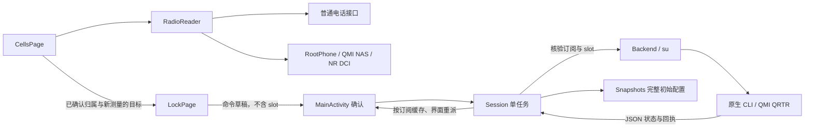

# CellLock 开发交接（0.4 自适应读取接入）

本文面向继续开发的工程师，随完整源码和 GPL-3.0-only 许可证使用。源码仓库：[CellLock-QMI](https://github.com/SAGIRIxr/CellLock-QMI)；下载入口：[v0.3.0](https://github.com/SAGIRIxr/CellLock-QMI/releases/tag/v0.3.0)。文中路径均相对于源码项目根目录，其余构建、协议及测试说明不依赖聊天记录。

## 1. 先了解当前边界

CellLock 是面向已 Root 高通 Android 手机的本地网络设置工具，当前实测设备为小米 14 Pro / SM8650 / Android 14。应用为 Java 原生界面，后端为 NDK 编译的 arm64 C 可执行程序，经 Root 使用 QMI / QRTR。没有联网权限、广告、账号或会员模块。

0.4 在 `modifications` 分支本地接入自适应读取，未发布、未上传。正式 Activity 已在小米 M2012K11AC / SM8250 / Android 13 / MIUI 14 验证：电话、精确及近似位置权限全部拒绝、系统定位关闭时仍可取得两卡 Root 电话测量与设备级 NR 邻区；还验证了普通接口、厂商 AppOps 受限回退、Root 拒绝及恢复、旋转和后台退出。条件与限制见 [开发交接文档](#1-先了解当前边界)。

无新增 Root 开关，也无自动授权或定位设置修改。普通订阅受限时依次尝试 Root 电话、UIM 和公开卡状态；小区优先使用有新时间戳的普通接口，受限或只有旧缓存时尝试 Root 电话。0.4.4 起 Root 可用且映射未改变时，即使电话已有完整服务身份也补读严格绑定的 NAS，再补充设备级 NR DIAG。UIM-only 不伪造 subId；NAS/DCI 时间或映射未完成核验时不冒充可信服务测量，同频候选资格见下方 0.4.2 说明。Session 写入前后均重新读取真实订阅映射，缓存只用于界面草稿。

已通过：读取解析 364 项（含既有双卡原始回包和 30 个 NR 日志）、输入 46 项、历史 22 项、SIM 状态 8 项、快照 136 项及原生 mock 协议 105 项；构建与 lint 通过（0 errors / 25 warnings）。正常 DCI 会话能退出、后台无读取子进程或临时目录残留；厂商初始化挂死、异常注销及其他设备适配尚未真机演练。

本轮修复 APK 安装目录的 linker namespace 无法加载厂商 libdiag：仅将自编 DIAG ELF 放入 Root 私有 `/data/local/tmp` 临时目录执行，正常退出删除，不复制厂商库或修改系统配置。DIAG 单次无日志时独立保留最多 60 秒的已接收观测并标年龄，不参与曲线或锁定。Root 重新允许后，手动刷新会补读真实订阅，保留原先所选物理槽。

0.4.1 后续修复：系统返回 PCI 不可用时保留有效信号，仅限制目标；Root 可用时仍尝试补全身份。DIAG 从只取最后一包改为合并短会话的最多 32 包 / 96 KiB，避免漏掉前面包中的邻区。当前主机检查 689 项、原生缓冲边界自检通过，普通读取回归有同权限下的新旧正式包对照。详细条件及本轮恢复基线见上述读取验证记录。

0.4.2 按用户要求放宽候选资格：诊断 / NAS 邻区只要与当前服务制式、频段、频点一致且 PCI 合法，最近接收的观测可填入所选 SIM 的锁定表单；不伪造 SIM 归属、原始测量时间或服务角色。写入参数及订阅到卡槽核验仍由原流程负责。`DiagnosticCells` 合并最近 15 秒诊断观测，每个小区独立过期；选卡、服务频段或频点变化清空，读取无包后等待 5 秒再探测。普通 / Root 电话逐字段处理不可用值，NAS / DIAG 已知占位 PCI 不再丢弃整条记录；未知协议、截断、非法非占位身份仍拒绝。保留并显示可得的 RSRQ、SINR、RSSI、CSI 指标、CI/NCI、TAC、MCC/MNC、运营商、角色及频段来源；其他来源的有效记录不会因补读覆盖而消失。主机检查见本轮读取验证记录，其他机型及实际 NR 驻留不据此认定通过。

0.4.3 工作区审查修复：空结果的权限引导不再次调用手动刷新，恢复现有 5 秒调度；权限历史按 `permissionAsked:<权限名>` 分别保存，旧的统一标记不阻止首次申请另一权限。NR 同频候选的推算频段通过现有 `Bands.nrBandForArfcn` 优先匹配已知服务频段，真实系统报告的频段不覆盖；邻区显示及锁定表单使用同一规则。DIAG 入口连续两轮无包后重新尝试两个入口，手动刷新重置探测，不推断 processor 与 SIM 的对应关系。NAS 保留服务 PLMN、TAC、CI/NCI，LTE 邻区不继承服务标识；ICCID 始终脱敏，测试归档单独脱敏网络字段。读取完整性统一使用 `RadioCell.hasMappedIdentity`，仍与写入资格分开。`RootShell.quote` 及已有频点常数复用；删除无调用的 `CellsPage.serving()` 和重复命令拷贝。原生编译集中到 `native/build.ps1`，根目录脚本仅转调，原有输出位置与入口保持可用。

0.3 已完成的验证：

- App 界面设置 SIM 1 的 LTE B3、SIM 2 的 NR SA + NSA n1 / n78，独立读取确认后恢复完整原始频段位。
- 直接调用 APK 同一后端验证 SIM 1 RAT 28→16→28，SIM 2 RAT 92→80→92，SIM 2 NR mode 0→2→0；完整偏好与原值一致。这部分不是 App 按钮触发。
- App 设置 SIM 2 LTE EARFCN 1650 / PCI 321，独立 GET 确认锁定配置；App 解除后再次读到 LTE 空列表。同期系统界面显示的是 5G NR 服务，不能据此宣布 LTE 目标驻留已验证。
- 已出现真实 NR 系统观测：n1、ARFCN 422930、PCI 633、约 -116 dBm。这是读取证据，**不是 NR 小区锁或 NR ARFCN 锁定成功证据**，也不能直接补出未测得的 SCS。
- `assembleDebug` / `lintDebug` 通过，lint 0 errors / 19 warnings。快照 136 项、输入校验 46 项、信号历史 22 项、原生纯协议 105 项通过。
- 最终包已安装；三页与频段页均有真实截图，前台新时间戳采样、曲线绘点、切卡清历史、回执横竖旋转保留已观察。后台暂停本轮未单独计数验收，整套初始恢复 / 全部开放仍未完成真机验收。
- 最终两卡偏好与 LTE / NR 小区状态均与各自基线一致；其中 NR 状态仍未知。双卡移动数据关闭，漫游设置为 0，无 cellular INTERNET 网络；原始流量计数不作为零计费证明。

5G 小区锁和 NR ARFCN 锁定已有实现，但真实设置、配置回读、驻留、解除尚未完成整套验收。出现 NR 服务后，NR 锁状态 GET 仍是 ackOnly，不能据此恢复未知的原锁状态，因此本轮没有贸然追加 NR 小区写入。测试期间移动数据与漫游保持关闭；两张 SIM 都可参与可逆测试，必须分别保存原值并恢复。详细证据和后续更新统一维护在 `native/VALIDATION.md`，旧版历史在 `native/VALIDATION-0.2.md`。

## 2. 目录与职责

| 文件 | 主要职责 |
|---|---|
| `app/src/main/java/com/celllock/app/MainActivity.java` | 三页容器、SIM 选择、确认弹窗、权限、导出，以及进程内 `Session` 任务协调 |
| `CellsPage.java` | 前台读取调度、服务 / 邻区、来源与缓存、信号曲线；交给统一协调器读取 |
| `RadioReader.java`、`SimInfo.java` | 按接口选路、真实 SIM 映射、回调取消与设备能力退避 |
| `RootShell.java`、`RootPhone.java` | 串行有界 Root 进程、电话服务 helper；不修改权限或系统开关 |
| `MeasurementDecoder.java` | 有界 UIM/NAS 与 NR 2.7 解码，拒绝未知版本或不完整身份 |
| `LockPage.java` | 小区 / 频段 / 制式表单，硬件频段芯片，参数校验，生成待确认命令 |
| `DevicePage.java` | 机型 / SoC / 版本、硬件频段、权限、后端状态与记录 |
| `Backend.java` | 订阅 ID 转物理卡槽，调用随包 ELF，收集与解析 JSON |
| `Models.java` | `Rat`、`ModemState`、`ModemResult`；未知状态和偏好 / 硬件分离 |
| `Snapshots.java` | 每张卡首次完整偏好快照、恢复命令生成、最终全值匹配 |
| `RadioCell.java`、`Bands.java` | 系统 CellInfo 简化、频段查找与 SCS 建议；建议值不是测量值 |
| `SimStatus.java` | 区分电话未授权、SIM 信息读取受限、无卡和可用订阅 |
| `SignalHistory.java`、`SignalChartView.java` | 真时间戳去重、滚动窗口、断线、Canvas 绘图 |
| `Ui.java`、`FlowLayout.java`、`LineIcon.java` | 配色、控件、流式芯片与本地矢量图标 |
| `InputValidator.java` | 输入范围、频段与频点等约束 |
| `native/celllock_qmi.c`、`qrtr_transport.inc` | 固定 CLI、QMI 编码 / 解码、严格 SIM 绑定、读后验证 |
| `native/celllock_read.c`、`celllock_diag.c` | 固定只读查询和短 DCI 会话，未确认正常清理时暂停基带操作 |
| `native/test_qmi.c`、`test_transport.inc` | 完全替换真实传输的原生测试；不访问基带 |
| `tests/*.java` | 参数、快照、信号历史纯逻辑测试 |

核心调用关系：



公开源码不包含本地 `AGENTS.md` 和私人设备记录；接手时以本交接文档及 `native/VALIDATION.md` 为基线，先读取新设备状态，避免沿用旧机器配置。

## 3. 前台刷新与图表

`CellsPage` 由 Activity 调用 `setSim()`、`setForeground()`、`setBusy()` 和 `dispose()`。

- 小区页前台请求完成后约 5 秒安排下一次，页面 30 秒超时；普通更新 4 秒后转入回退，Root helper 各自有期限。只有一个定时 Runnable 和一个有效在途请求。
- callback 必须同时匹配请求 generation、捕获的 subscription ID、前台状态、非 busy 状态和 reading 标记。旧请求不得结束或覆盖新请求。
- 暂停、销毁、切 SIM 时取消定时与超时回调，增加 generation；迟到的系统回调会被丢弃。
- Session 读取或写入期间暂停观测，任务结束后恢复。普通权限/定位只限制具体系统小区接口，Root 读取路径仍尝试；只有手动操作在实际来源不可用时引导授权。无 SIM 映射仍可显示设备级观测。
- `SimStatus` 区分未授权、读取受限、无卡和正常订阅；Root 提供真实订阅时界面可以选择卡，但设备页仍准确显示主 App 电话权限未授予。UIM 与公开卡状态不补造 subId，未知归属不能作为锁网目标。
- 瞬时空列表与超时保留最近有效列表，注明接收年龄；超过 60 秒或未知时间的目标不可填入。Root 拒绝后自动轮询不反复请求，手动刷新可重试；DIAG 无日志退避 60 秒，库/ABI/版本不支持时暂停，手动刷新可重新探测。
- `CellInfo.getTimestampMillis()` 与 `SystemClock.elapsedRealtime()` 使用同一时间基准。相同 / 倒序 / 未来 / 超过窗口的时间戳不产生新点；不能用 callback 到达时间伪造采样。
- 最近 5 分钟、最多 60 点。LTE RSRP 与 NR SS-RSRP 使用相同图表，但 RAT、频点、PCI、身份变化时断线；空观测、后台、超时也断线，不填零或插补。
- 切卡清历史；同卡旋转通过 Bundle 保存样本，恢复后先断开连线。信号颜色和“强 / 弱”仅为应用参考。

不要把“每 5 秒请求”改写成“每 5 秒保证新样本”，也不要每次自动刷新都写操作日志，避免重要写入回执被挤掉。

## 4. Session 与旋转恢复

`MainActivity.Session` 是静态进程内对象，持有单线程 executor、running 状态、按 subscription ID 分类的状态 / 时间 / 记录，以及最新 Completion。它只弱引用 Activity，后台任务持有 ApplicationContext。

执行写入的顺序是：

1. 确认弹窗捕获 subscription ID、slot 和命令副本；确认时再次核验目标。
2. Session 每条命令前后都核验订阅是否仍对应原 slot；映射改变就停止后续命令并保留未知结果。
3. 写前先执行 `state`。只有取得完整可恢复快照，才执行后续写入。
4. 执行固定命令，保存原始回执；一般操作遇失败停止，初始恢复会继续收集各恢复项结果。
5. 最后重新读取。初始恢复额外执行 `Snapshots.matches()`，不能只看每一步的 ACK。
6. 主线程派发 Completion，按 ID 防止重复消费；Activity 回到前台或旋转后继续接收结果。

旋转时 Activity 不取消已经开始的基带操作。旧界面 detach，executor 允许在途任务收尾；新界面 attach，继承 busy 和回执。可见的结果弹窗另存 Bundle，旋转后可重建。不要把耗时 `su` 调用放回主线程。

Session 不跨进程死亡持久化。进程被系统终止后，需要重新读取状态，未完成任务的回执不会自动恢复；SharedPreferences 中的完整初始快照仍保留。

## 5. 原生 CLI 与协议

`libcelllock_qmi.so` 虽然扩展名为 `.so`，实际是可执行 ELF，用于随 APK 打包；不是通过 JNI 加载。必须保留 `extractNativeLibs=true`，从 `nativeLibraryDir` 的实际文件路径执行。

| 命令 | 作用 |
|---|---|
| `state <slot>` | 只读状态及硬件能力 |
| `cell-lte <slot> <earfcn> <pci>` | LTE 小区锁 |
| `cell-nr <slot> <arfcn> <pci> <band> <scs>` | NR PCI 小区锁 |
| `freq-nr <slot> <arfcn> <scs>` | NR ARFCN 频点锁 |
| `cell-clear <slot> lte\|nr\|all` | 解除所选 QMI 小区锁 |
| `band-lte <slot> <列表\|all>` | LTE 频段 |
| `band-nr <slot> sa\|nsa\|both <列表\|all>` | NR SA / NSA 频段 |
| `band-gsm <slot> <列表\|all>` | GSM 850 / 900 / 1800 / 1900 |
| `band-wcdma <slot> <列表\|all>` | WCDMA 频段 |
| `rat <slot> <gsm,wcdma,lte,nr组合\|all>` | 网络制式 |
| `nr-mode <slot> both\|nsa\|sa` | 5G 组网 |
| `reset <slot>` | 开放硬件支持范围、SA+NSA，并请求清小区锁 |

`slot` 是物理卡槽 0/1，不是 Android subscription ID。列表是逗号分隔数字。LTE EARFCN 限 0–65535、PCI 0–503；NR ARFCN 0–3279165、PCI 0–1007；SCS 单位 kHz，只接受 15/30/60/120/240。普通 UI 命令不携带 slot，由 Session 统一插入；`Snapshots.restoreCommands()` 输出带 slot，MainActivity 转换后再交 Session，改接口时注意避免重复插槽。

协议关键点：

- NAS service 3，绑定消息 0x0045 必须成功；DMS service 2 的同号消息是硬件频段查询，不能混淆。
- LTE GET/SET：0x00D7 / 0x00D8。GET EARFCN 为 16 位，SET 为 32 位，现版本因此限制 LTE 范围以保证可验证。
- NR GET/SET：0x010F / 0x010E。type 0 为 PCI，1 为 ARFCN，2 为 NONE。PCI payload 包含 PCI、SCS 枚举、ARFCN 和 64 字节频段掩码。
- System selection GET/SET：0x0034 / 0x0033；GET 与 SET 的扩展 LTE、NR SA / NSA TLV 编号不同。详细映射见 `native/SOURCES.md`。
- RAT 的 GSM/WCDMA/LTE/NR 位为 0x04/0x08/0x10/0x40；NR mode 的 0/1/2 为 both/nsa/sa。
- 系统选择可能异步生效，后端有限期重复读取。原生期限 25 秒，App 每次 Root 外层等待 40 秒。只有明确的不支持错误才允许协议字段降级，超时不得当成“未写入”后随意重发。

回执是一行 JSON。`ok` 表示本次目标通过回读；`mutated` 是尝试写入，`writes` / `accepted` 分别记录次数；`stage=unverified` 可能已有部分变更。状态包含 `lteCell`、`nrCell`、`pref`、`hardware`，缺失 hardware 可从同订阅先前结果继承，不能跨卡继承。

## 6. 快照与恢复必须守住的约定

快照键包含物理 slot 和 subscription ID；schema 2 要求完整、可恢复的偏好，包括 16 位十六进制 `legacyMask`。首次完整读取用同步 `commit()` 保存；后续写前再次检查已保存快照可用。

“恢复初始设置”恢复频段、RAT、NR mode，并请求清小区锁；**没有保存或恢复之前的小区锁目标**。NR SA 与 NSA 原值不同，必须分别恢复。完整比较保留硬件不支持位，例如 B250 / B252 / B255，不可先与硬件掩码求交集。GSM / WCDMA 共用 legacy mask，写单一族需保留其他族及未命名位；最终 raw mask 不一致就不能称原样恢复。

“全部开放”使用硬件支持范围，不等于初始状态。每个目标——LTE、NR SA、NR NSA、legacy、RAT、NR mode、LTE / NR 小区锁——均须独立验证，不能因为频段改好了就报告整个恢复成功。

`nrCell.ackOnly=true` 只是“GET 返回成功结果 TLV、却没有可解码状态”。它不能解释为 NONE。PCI / ARFCN 设置后的参数不完整、清除后仍 ackOnly，都必须保持未知或未全部确认。不要为了让界面变绿而改成默认未锁定。

## 7. 构建、安装和纯测试

工具：JDK 17、Android SDK platform 35、Build Tools 35.0.0、NDK 30.0.14904198。工程使用 AGP 8.7.3、Gradle Wrapper 8.11.1、Java 17；minSdk 30 / targetSdk 34，仅打包 arm64-v8a 后端。先按本机实际位置配置 `JAVA_HOME`、`ANDROID_SDK_ROOT`，再在源码根目录运行 PowerShell：

```powershell
$sdk = $env:ANDROID_SDK_ROOT
$ndk = Join-Path $sdk 'ndk/30.0.14904198'
Set-Content -LiteralPath local.properties -Value ('sdk.dir=' + $sdk.Replace('\','/'))
./build-native.ps1 -Ndk $ndk -BuildTests
./gradlew.bat clean assembleDebug lintDebug
```

APK 在 `app/build/outputs/apk/debug/app-debug.apk`。首次安装使用开发签名；继续更新需保持签名，否则不能覆盖旧安装。卸载会丢失 App 保存的初始快照，应先恢复并导出记录。

日常开发可省略 `clean`。交付前完整重打包，避免 APK 增量更新留下已失效条目的空隙；不要通过移除读取组件来缩减这类打包空间。

```powershell
adb devices
adb install -r app/build/outputs/apk/debug/app-debug.apk
```

手机上通过 Root 管理器单独授权 `com.celllock.app`，电话 / 精确位置权限及定位开关由界面引导。多设备连接时请自行选定 adb 目标，不要依赖列表第一项。

完整主机纯逻辑测试可通过 `tests/run-host.ps1` 执行。`org.json` 是测试运行库，不加入 Gradle 生产依赖；SDK 的 JSONObject 仅是 stub，不能直接执行。获取独立 [JSON-java 测试 jar](https://repo.maven.apache.org/maven2/org/json/json/20240303/json-20240303.jar) 后，将 `$jsonJar` 设为其本地路径：

```powershell
./tests/run-host.ps1 -AndroidJar "$env:ANDROID_SDK_ROOT/platforms/android-35/android.jar" -JsonJar $jsonJar
```

可选 `-Captures <本地 device-paths 目录>` 额外验证既有脱敏真机数据。固定测试时钟只在 `tests/host/` 使用，不打入 APK；此测试不代替系统时钟、权限或 Binder 的真机回归。

Root 子进程退出保护可运行 `./tests/run-root-shell.ps1 -JsonJar $jsonJar -Jdk <JDK目录>`（需要本机 GCC，沿用上述 JSON 测试运行库）。脚本在临时目录编译假 `su.exe`，覆盖正常回包、业务错误、注销失败、watchdog 和信号退出，以及手动重试不能解除写入保护；不调用真实 Root 或基带。

`ReadingPolicyTest` 覆盖 DIAG 入口选择，以及电话已有服务身份时 NAS 补入异频邻区、去重、部分字段与冲突身份保留；`RadioCellTest` 包含 n77/n78 重叠频段、显示 / 填表一致性及可信服务优先；`MeasurementDecoderTest` 核对 NAS 标识的端序、占位值和邻区归属边界。`native/test_read` 与 `test_diag` 都只做内存自检，不发送基带请求。

0.4.6 的 `NasVerificationTest` 覆盖错误频段校正、合法频段保留、重叠候选、前后服务身份核验、无效信号、单项查询失败及双卡 NR 独立解码；默认重放 `tests/fixtures/nas-verified.redacted.jsonl` 的两卡真机格式。夹具已将网络标识置零，不包含可识别的 CI/NCI/TAC/PLMN。

`UiFlowTest` 在 Android instrumentation 中实例化真实页面，用记录命令的 Host 检查重排后的 NR / LTE 小区、频点、解锁与频段参数，不执行命令；还检查表单重建、精简字段以及 320dp / 130% 字体下的信号文字。先用同一默认 debug 签名安装当前 APK，再运行下列命令；脚本使用 SDK 35 / Build Tools 34.0.0 和本机默认 debug keystore，临时测试包运行后卸载，不打入正式 APK。仅连接目标设备，测试会停止目标应用：

```powershell
./tests/run-ui.ps1 -Sdk $env:ANDROID_SDK_ROOT
```

测试 APK 还包含显式只读真机验收 `DeviceReadingTest`，默认 UI 脚本不会运行它。单独重新安装 `tests/ui-test/build/ui-checks.apk` 后，运行 `adb shell am instrument -w com.celllock.app.tests/com.celllock.app.DeviceReadingTest`：使用实际 App UID、现有权限、Root 及 `RadioReader`，逐卡核对新 QMI 查询、服务身份、频段补入及 DIAG 候选。完成后卸载 `com.celllock.app.tests`；权限组合验证应在外部记录并恢复原有授权、标志与 AppOps，测试类本身不修改权限或网络设置。它要求被测设备接口可用且采样期间服务稳定，不是通用设备能力判定器。

0.4.4 的页面副标题、SIM 来源后缀、当前连接详情及采集来源说明已隐藏；邻区保留来源和信号质量，底层 `details` 与诊断能力保持。锁定页按制式 / 频段 / 小区、NR / LTE 排序，读取失败仍显示未知。NAS 仅补充新观测，不覆写已有电话数据；相同制式、频点、PCI 且身份不冲突时去重，纯频点提示不重复已有小区。服务选择先比较可信映射，再比较 NR / LTE 和身份完整度，避免补读 NR 抢占已映射 LTE。

0.4.5 邻区隐藏系统 / Root 电话来源的可见文字与无障碍来源播报，仍保留原始数据用于诊断。小区采集进行中或被设置任务暂停时显示提示；新鲜观测不因普通刷新禁用，过期观测继续拒绝填表。Android 检查补入真实 Root 电话邻区夹具，以及离页后观测变旧、回页禁用和读取 / 设置暂停提示，避免仅用 DIAG 夹具漏测来源。

`PermissionFlowTest` 在 Android runtime 调用当前 APK 的权限判断及引导方法，用内存偏好与测试上下文检查分步授权和空结果不再手动重读，不调用系统授权或改变设置。完成 APK 构建后可单独运行（测试类不打入 APK）：

```powershell
$androidJar = Join-Path $env:ANDROID_SDK_ROOT 'platforms/android-35/android.jar'
$buildTools = Join-Path $env:ANDROID_SDK_ROOT 'build-tools/34.0.0'
$appClasses = 'app/build/intermediates/javac/debug/compileDebugJavaWithJavac/classes'
New-Item -ItemType Directory -Force tests/device-classes, tests/device-test/build | Out-Null
& "$env:JAVA_HOME/bin/javac.exe" -encoding UTF-8 -cp "$appClasses;$androidJar" -d tests/device-classes tests/PermissionFlowTest.java
& "$env:JAVA_HOME/bin/jar.exe" cf tests/device-test/build/test.jar -C tests/device-classes .
& "$buildTools/d8.bat" --min-api 30 --lib $androidJar --classpath $appClasses --output tests/device-test/build tests/device-test/build/test.jar
adb push tests/device-test/build/classes.dex /data/local/tmp/celllock-permission-test.dex
$apkOnDevice = (adb shell pm path com.celllock.app).Trim().Replace('package:', '')
adb shell "su -c 'CLASSPATH=${apkOnDevice}:/data/local/tmp/celllock-permission-test.dex app_process /system/bin com.celllock.app.PermissionFlowTest'"
adb shell rm -f /data/local/tmp/celllock-permission-test.dex
```

以上默认单设备；多设备连接时为每个 adb 命令指定目标。测试 helper 使用系统上下文初始化 Android 资源；MIUI 可能输出主题文件缺失日志，以退出码 0 和最终 PASS 为通过依据。

参数、曲线与 SIM 状态测试可直接在 PC JDK 运行：

```powershell
$javac = Join-Path $env:JAVA_HOME 'bin/javac.exe'
$java = Join-Path $env:JAVA_HOME 'bin/java.exe'
New-Item -ItemType Directory -Force tests/local-classes | Out-Null
& $javac -encoding UTF-8 -d tests/local-classes app/src/main/java/com/celllock/app/InputValidator.java tests/InputValidatorTest.java app/src/main/java/com/celllock/app/SignalHistory.java tests/SignalHistoryTest.java app/src/main/java/com/celllock/app/SimStatus.java tests/SimStatusTest.java
& $java -cp tests/local-classes com.celllock.app.InputValidatorTest
& $java -cp tests/local-classes com.celllock.app.SignalHistoryTest
& $java -cp tests/local-classes com.celllock.app.SimStatusTest
```

快照测试依赖 Android `org.json`，不能用 SDK 的 stub jar 直接当桌面运行库。可将当前模型和测试编译为 dex，在 Android runtime 执行；这只运行内存逻辑，不调用后端：

```powershell
$sdk = $env:ANDROID_SDK_ROOT
$javac = Join-Path $env:JAVA_HOME 'bin/javac.exe'
$java = Join-Path $env:JAVA_HOME 'bin/java.exe'
$jar = Join-Path $env:JAVA_HOME 'bin/jar.exe'
$androidJar = Join-Path $sdk 'platforms/android-35/android.jar'
$d8 = Join-Path $sdk 'build-tools/35.0.0/lib/d8.jar'
New-Item -ItemType Directory -Force tests/snapshot-classes | Out-Null
& $javac -encoding UTF-8 -cp $androidJar -d tests/snapshot-classes app/src/main/java/com/celllock/app/Models.java app/src/main/java/com/celllock/app/Snapshots.java tests/SnapshotsTest.java
& $jar --create --file tests/snapshot-classes.jar -C tests/snapshot-classes .
& $java -cp $d8 com.android.tools.r8.D8 --lib $androidJar --min-api 30 --output tests/snapshot-tests.jar tests/snapshot-classes.jar
adb push tests/snapshot-tests.jar /data/local/tmp/celllock-snapshot-tests.jar
adb shell 'CLASSPATH=/data/local/tmp/celllock-snapshot-tests.jar app_process /system/bin com.celllock.app.SnapshotsTest'
```

原生测试已由 `build-native.ps1 -BuildTests` 生成。它用 mock transport 替代真实 QRTR，可直接运行：

```powershell
adb push native/test_qmi /data/local/tmp/celllock-test-qmi
adb shell chmod 755 /data/local/tmp/celllock-test-qmi
adb shell /data/local/tmp/celllock-test-qmi
```

也可在带 GCC 的 Linux 环境从 `native/` 编译 `test_qmi.c`，用 `-std=c11 -O2 -Wall -Wextra -Werror` 后执行。纯测试通过不等于手机已支持所有写命令。

## 8. 后续开发优先级

1. **完成真实 NR 验证**：重新获取当前目标及其完整参数，核对 ARFCN 含义和 SCS；分别记录 SET、完整 GET、实际驻留、解除、最终原值。已有 n1 观测不要写死为未来默认值。
2. **补足恢复整流程**：初始恢复与全部开放分别验证；当 NR 查询仍未知时，验证界面正确保留部分成功和待确认结果。保持移动数据关闭。
3. **继续双卡 / 生命周期回归**：任务中旋转、后台返回、重复点击、权限撤回、SIM 映射变化、Root 拒绝、命令超时；回执不能串卡或丢失。
4. **收敛 lint 与 UI**：逐项复核 warnings；Root 电话隐藏 API 有明确跨 ROM 风险，失败必须回退，不能宣称通用支持。不同字体缩放 / 屏幕宽度，长频段列表和日志不能遮挡恢复入口。
5. **更广机型适配**：先只读确认服务、消息与字段，再有条件开放写入；未知字段保留原始证据，不套旧 EFS 布局或自动修改基带环境。

发布时更新 `versionCode` / `versionName`，重新构建 native 和 APK，运行纯测试及有影响的真机回归，更新 `VALIDATION.md`、许可与来源，再打包源码。公开交付不包含 `local.properties`、签名私钥、个人路径、设备标识或未经整理的原始设备记录。

## 9. 许可与来源

项目为 **GPL-3.0-only**，修改后发布 APK 时应同步提供相应完整源码、构建所需文件和许可证，保留来源说明。

- QRTR 传输参考 [btsearch/bunnylock](https://github.com/btsearch/bunnylock)，固定提交 `a0dc51f85e2f34431dfc5f82a42b8b7482cb8790`。
- QMI 编码参考 [Fronsipswu/qcom-band-menu](https://github.com/Fronsipswu/qcom-band-menu)，固定提交 `a66248e383f02899bab36a2401d8470d45e18ac9`。
- 具体字段、错误码核对与未复制的厂商资料范围见源码 `native/SOURCES.md`。

不使用或分发 Cellular-Pro 私有代码、授权逻辑或手机厂商 `libdiag.so`。当前软件无需会员服务、遥测或联网 SDK，后续开发保持这一产品约定。
